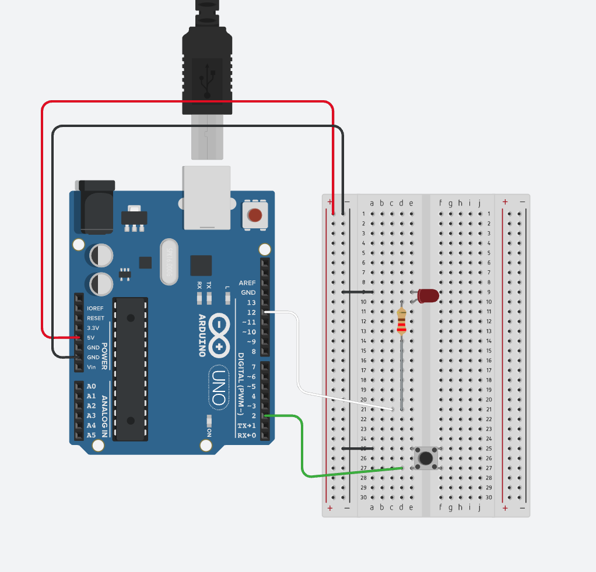

# Press Button Lights On

An Arduino Uno project that turns an LED on for **2 seconds** when a pushbutton is pressed, then switches it off automatically.

The LED stays off at rest. Holding the button does not repeat the timer: release it before pressing again.

## Circuit



## Components

- Arduino Uno and USB cable
- Breadboard and jumper wires
- Momentary pushbutton
- LED
- 220–330 Ω resistor in series with the LED

## Wiring

Disconnect USB power while changing the wiring.

| Connection | Destination |
| --- | --- |
| Arduino GND | Breadboard minus (−) rail |
| Digital pin 2 | One switched terminal of the button |
| Other switched button terminal | Minus (−) rail |
| Digital pin 12 | LED series resistor |
| Other end of the resistor | LED anode (+, long leg) |
| LED cathode (−, short leg / flat side) | Minus (−) rail |

Use two button terminals that connect **only when pressed**. On a four-leg tactile button, some legs are already connected internally.

The screenshot includes a 5V wire to the plus rail. That rail is unused by this circuit, so the 5V wire is optional.

## Why the button connects to ground

The sketch uses `pinMode(BUTTON_PIN, INPUT_PULLUP)`, which enables a resistor inside the Arduino between pin 2 and 5V.

```text
5V ── internal pull-up resistor ── pin 2 ── button ── GND
```

- Released: pin 2 reads `HIGH`.
- Pressed: pin 2 reads `LOW`.

No external pull-down resistor is needed. The LED still needs its own series resistor. Do not replace a pull-down resistor with a direct ground wire while keeping a button connection to 5V; that can short 5V to ground when pressed.

## Upload and test

1. Open [Press_button_light_on.ino](Press_button_light_on/Press_button_light_on.ino) in Arduino IDE.
2. Connect the Uno with a USB data cable.
3. Select **Arduino Uno** and the connected serial port.
4. Upload the sketch.
5. Press the button. The LED should light for 2 seconds, then turn off.
6. Release and press again to repeat.

The sketch includes a 30 ms debounce delay. It uses `delay()`, so it does not process additional presses during the 2-second lighting period.

## Change the duration

In the sketch, change `delay(2000)` to `delay(3000)` for 3 seconds. The value is in milliseconds.

## Videos

Original demonstration recordings:

- [Video 1 — IMG_0093.MOV](media/IMG_0093.MOV)
- [Video 2 — IMG_0094.MOV](media/IMG_0094.MOV)

If GitHub does not play a MOV file inline, download it to watch it.

## File catalog

```text
.
├── README.md
├── Press_button_light_on/
│   └── Press_button_light_on.ino
└── media/
    ├── wiring.png
    ├── IMG_0093.MOV
    └── IMG_0094.MOV
```

The Arduino sketch and original media are included as supplied.
